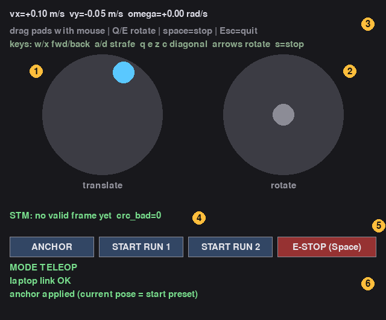

# 현장 CLI — 노트북과 Pi 구분

**기본 실행: S1 plan 분리**. `start`만으로 ORB CPU 1·2 / 상위+plan CPU 0 / 하위 CPU 3 / RT 50을 사용한다. S0 비교 때만 `--sync-plan`을 붙인다. 모터 없는 FAKE가 기본이고, 실기는 `--real`을 명시한다. 출발 전 모터 없는 시험부터 진행하려면 [TESTS_BEFORE_FIELD.md](TESTS_BEFORE_FIELD.md)를 먼저 따른다. 초기 배치·보정은 [배포 설정 안내](deployment/ksrc/README.md), 실제 시험 기준은 [FIELD_TESTS.md](FIELD_TESTS.md)에 있다.

## 0. 터미널 역할

| 터미널 | 실행 위치 | 용도 |
|---|---|---|
| **A** | 노트북에서 SSH 접속한 **Pi** | 실행·anchor·MPPI·E-stop·종료 |
| **B** | 노트북에서 별도로 SSH 접속한 **Pi** | 로그·상태 관찰 |
| **C** | **노트북 로컬**, SSH하지 않음 | 화면 조이스틱 GUI 실행 → 종료 후 로그 다운로드 |

명령 블록 위의 위치를 확인하고 실행한다. A/B/C 변수는 공유되지 않는다. Pi에서 사용하는 `./ksrc`와 로그 수집기를 노트북 로컬에서 실행하지 않는다. 서버·VPN·인터넷은 현장 실행에 필요 없다.

## 1. 같은 AP에 연결하고 Pi에 SSH 접속

**[터미널 A · 노트북 로컬]** — IP를 공유기에서 확인한 실제 Pi 주소로 변경한다.

```bash
PI_AP_IP='192.168.0.101'
ping -c 3 "$PI_AP_IP"
ssh -o HostKeyAlias=raspberrypi.local pi@"$PI_AP_IP"
```

**[터미널 A · Pi SSH, 접속 후]**

```bash
hostname
cd /home/pi/ksrc_final_20261022/deployment/ksrc
./ksrc check
```

`check` 실패 시 먼저 원인을 해결한다. 현장에서 pip/apt 설치·git pull은 필요 없다. 현재 확인한 Pi IP는 `192.168.0.101`, 노트북 LAN은 `192.168.0.100`이다. DHCP라 재할당될 수 있다. 노트북 LAN→공유기 LAN, Pi Wi-Fi→`home` 2.4 GHz 구성이다. 노트북 Wi-Fi 핫스팟은 인터넷용으로 별도 유지한다.

## 2. 실기 세션과 로그 폴더 만들기

이후는 **실제 SPI·모터 제어**를 여는 명령이다. 시뮬 검증 후 바퀴를 띄운 시험부터 진행하고, 기존 직접 SPI 제어는 종료한다. 한 번에 세션 하나만 실행한다. 모터 없는 확인은 [사전 테스트 설명서](TESTS_BEFORE_FIELD.md)를 따른다.

**[터미널 A · Pi SSH]**

```bash
TEST_DIR="state/field_S1_$(date +%Y%m%d_%H%M%S)"
mkdir -p "$TEST_DIR"
printf '%s\n' "$TEST_DIR" > state/latest_test.txt
date -Is | tee "$TEST_DIR/actions.log"
./ksrc check 2>&1 | tee "$TEST_DIR/check.log"
./ksrc --state-dir "$TEST_DIR" start --real
nohup bash record_load.sh "$TEST_DIR" 600 > "$TEST_DIR/load_collector.log" 2>&1 < /dev/null &
echo "collector_pid=$!" | tee -a "$TEST_DIR/actions.log"
./ksrc --state-dir "$TEST_DIR" view | tee -a "$TEST_DIR/actions.log"
```

**예상 출력:** `started REAL supervisor ...`, `plan: S1 async ; upper CPU 0 ; lower CPU 3 ; RT 50`. 시작 직후 `status unavailable` 또는 `초기화 중`이면 2초 뒤 `view`를 다시 실행한다. 계속 같으면 `tail -n 20 "$TEST_DIR/supervisor.log"`와 `runner.log`를 확인한다. 세션은 기본 최대 1시간, 부하 수집은 10분이다. 수집 시간을 늘리려면 실행 전에 `600`을 초 단위로 바꾼다(최대 3600초). 같은 폴더에서 수집기를 중복 실행하지 않는다. 명령 직후 상태 반영에는 한 차례 갱신 시간이 필요하므로 `status`와 B의 로그에서 수락 여부를 확인한다.

## 3. 관찰용 터미널 연결

**[터미널 B · 노트북 로컬]**

```bash
PI_AP_IP='192.168.0.101'
ssh -o HostKeyAlias=raspberrypi.local pi@"$PI_AP_IP"
```

**[터미널 B · Pi SSH, 접속 후]**

```bash
cd /home/pi/ksrc_final_20261022/deployment/ksrc
TEST_DIR="$(cat state/latest_test.txt)"
printf '관찰할 폴더: %s\n' "$TEST_DIR"
./ksrc --state-dir "$TEST_DIR" view --watch
```

B는 한국어 상태 화면을 관찰한다. 행렬·JSON을 계속 읽을 필요 없다. Ctrl+C는 보기만 끝낸다. 원시 로그가 필요할 때만 Ctrl+C 후 다음을 실행한다.

**[터미널 B · Pi SSH]**

```bash
./ksrc --state-dir "$TEST_DIR" view
tail -f "$TEST_DIR/policy.log"
```

`tail -f` 뒤의 명령은 Ctrl+C로 빠져나와야 입력할 수 있다.

## 4. 실제 화면 조이스틱 실행 — 노트북에서

**[터미널 C · 노트북 로컬, SSH하지 않음]** — 현재 확인한 checkout과 Python 경로를 그대로 적었다. GUI는 노트북 화면에서 실행한다. Pi에서 실행하거나 `ssh -X`를 쓰지 않는다.

```bash
cd /home/su/rover-mapping
PI_AP_IP='192.168.0.101'
/home/su/rover/.venv-mapping/bin/python -c "import pygame; print('pygame OK')"
/home/su/rover/.venv-mapping/bin/python teleop/ksrc_snapshot/pi/teleop/teleop_joystick.py \
  --udp "${PI_AP_IP}:5006" --gateway --grid-keys --rate 50 --max-lin 0.15 --max-ang 0.8
```

**예상 출력:** `pygame OK`, `[udp] -> 192.168.0.101:5006 (라파에서 control_gateway.py 실행 중이어야 함)`. 노트북에 translate/rotate 패드, 초록색 키 안내 줄(`keys: w/x fwd/back ...`), `ANCHOR`·`START RUN 1`·`START RUN 2`·`E-STOP (Space)` 버튼이 뜬다. 터미널 C는 GUI가 실행되는 동안 점유된다.

**다음 단계 조건:** GUI에 `MODE TELEOP`, `laptop link OK`가 나와야 한다. `GATEWAY: no status`가 계속 나오면 A의 스택 실행·Pi IP·포트 **5006**을 확인한다. `--gateway`만 붙여도 UDP 기본 포트가 5005이므로 **`:5006`을 생략하면 안 된다.** 별도 `udp_spi_bridge.py`·`run_policy.py`를 추가 실행하지 않는다. Pi의 `ksrc start --real`이 이미 하위 정책과 gateway를 관리한다.

### 조이스틱 화면과 사용법



| 번호 | 화면 위치 | 의미 |
|---|---|---|
| 1 | 왼쪽 원 `translate` | 병진 패드. 마우스로 끌면 파란 점이 따라가고, 손을 떼면 0으로 돌아온다 |
| 2 | 오른쪽 원 `rotate` | 회전 패드. 가로로만 반응한다 |
| 3 | 맨 위 글자 | 지금 내보내는 명령(`vx`, `vy`, `omega`)과 키 안내 |
| 4 | `STM: ...` | 로버(STM)가 실제로 받은 명령. `no valid frame yet`이면 아직 응답이 없는 것이다 |
| 5 | 버튼 줄 | `ANCHOR` · `START RUN 1` · `START RUN 2` · `E-STOP (Space)` |
| 6 | 맨 아래 초록·노랑·빨강 글자 | gateway 상태 줄. 아래 표 참고 |

키보드는 반드시 **`--grid-keys`로 실행**해야 한다(위 명령에 들어 있다). 이 옵션이 없으면 `qweasdzxc` 병진 키는 동작하지 않고 Q/E가 회전 키로만 쓰인다. 창을 클릭해 **포커스가 있는 상태**에서 누른다.

| 조작 | 동작 | 비고 |
|---|---|---|
| `w` / `x` | 전진 / 후진 | 키 병진 속도는 0.075 m/s(`--max-lin 0.15`의 50%) |
| `a` / `d` | 좌 / 우 병진 | 로버 정면은 그대로, 옆으로 이동 |
| `q` `e` `z` `c` | 대각선: 전방좌 / 전방우 / 후방좌 / 후방우 | 대각선도 같은 속력. 반대 키를 같이 누르면 상쇄 |
| `←` / `→` | 제자리 회전: 반시계 / 시계 | 0.4 rad/s(코드의 0.5배 적용) |
| `s` | 정지 | 누르고 있는 동안 병진·회전이 모두 0 |
| 왼쪽 패드 드래그 | 병진. 위=전진, 왼쪽=좌 병진 | 최대 0.15 m/s. 패드를 끄는 동안은 병진 키를 무시한다 |
| 오른쪽 패드 드래그 | 회전. 오른쪽=시계, 왼쪽=반시계 | 최대 0.4 rad/s. 끄는 동안은 `←` `→`를 무시한다 |
| 병진 키 + 오른쪽 패드 | 호를 그리며 주행 | 마우스는 하나라 패드 둘을 동시에 못 끌기 때문에 병진은 키로 한다 |
| Space 또는 `E-STOP` 버튼 | AUTO 해제·정지 요청 | GUI `MODE TELEOP`, B에서 명령 0 확인 |
| `ANCHOR` 버튼 | 지금 자세를 출발 preset으로 지정 | 로버는 움직이지 않는다. 5단계 참고 |
| `START RUN 1` / `START RUN 2` | 해당 회차 AUTO 요청 | 먼저 아래 anchor·준비 조건 충족, B에서 수락 확인 |
| Esc 또는 창 닫기 | GUI 종료 | AUTO 취소를 보장하지 않음. 먼저 E-STOP 확인 후 닫기 |

패드는 중심 10% 데드존이 있고, 앞·뒤·좌·우 축 10° 안쪽은 축으로 맞춰진다. 낮은 속도에서는 바퀴 축을 크게 바꾸는 방향 변화가 무시된다. 새 방향으로 조향하려면 패드를 35% 이상 민다.

| 상태 줄 | 뜻 |
|---|---|
| `MODE TELEOP`(초록) | 사람이 조종 중 |
| `MODE AUTO RUN n (joystick ignored)`(노랑) | MPPI 주행 중. 조이스틱 이동 명령은 무시되고 E-STOP만 동작한다 |
| `laptop link OK` / `laptop link LOST (AUTO keeps running)` | 노트북↔Pi 연결. 끊겨도 AUTO는 계속된다 |
| `anchor applied (current pose = start preset)` | `ANCHOR`가 받아들여졌다 |
| `not ready: stationary_s, orb_ok, in_region1` | START가 안 되는 이유. 3초 정지 / ORB 정상 / 출발 구역·정렬 중 모자란 것만 나온다 |
| `last start rejected: ...` | 마지막 START가 거절된 이유 |
| `GATEWAY: no status (check Pi gateway)`(빨강) | Pi에서 상태가 오지 않는다. 스택 실행·IP·포트 5006 확인 |

창 포커스를 잃거나 손을 떼면 수동 명령은 0이 된다. **AUTO는 GUI 포커스 변경·종료만으로 멈추지 않는다.** Space는 GUI 창이 키 입력을 받을 때 동작한다. GUI에서 E-STOP한 뒤 B의 상태와 실제 바퀴 정지를 함께 확인한다.

수동 이동은 실제로 로버가 움직이는 시험이다. 최초에는 바퀴를 띄워 확인하고, 이후 짧은 평지에서 정렬한다. 실제 맵 출발 위치가 아닌 곳에서는 GUI START 버튼을 누르지 않는다.

## 5. 출발 위치 정렬·anchor

로버 **base_link 중심을 site (3.60, 2.82) m**, 정면을 **site −y, yaw −90°**로 맞춘다. 정면은 body +x이며 site 좌표의 −y다. 15° 통로 진입 방향이다. 배치 그림은 [초기 위치 안내](deployment/ksrc/README.md#1-초기-위치와-방향)를 참고한다.

**[터미널 C · 조이스틱 GUI]** — `w` `x` `a` `d` 키(또는 패드)를 짧게 눌러 정렬한다. 아래는 GUI 대신 쓸 수 있는 **[터미널 A · Pi SSH]** 짧은 CLI 수동 명령이다.

```bash
# body 기준 전진 0.03 m/s, 1초 후 0 명령. 실제 로버가 움직인다.
./ksrc --state-dir "$TEST_DIR" teleop 0.03 0 0 --seconds 1
```

위치·방향을 맞추고 **3초 이상 정지**한다. 센서가 정상일 때 **[터미널 C · 조이스틱 GUI]**에서 `ANCHOR` 버튼을 한 번 클릭한다. 화면 아래에 `anchor applied (current pose = start preset)`가 뜨면 적용된 것이다. 정지 3초·ORB 정상이 아니면 거절되어 아무 일도 일어나지 않으니, `not ready:`에 남은 항목을 확인하고 다시 누른다. GUI 대신 CLI로 하려면 **[터미널 A · Pi SSH]**에서 실행한다.

```bash
./ksrc --state-dir "$TEST_DIR" anchor
```

어느 쪽이든 B에서 `operator_anchor` 이벤트를 확인한다. `anchor`는 로버를 움직이지 않는다. 적용 확인 후 준비 상태를 조회한다.

**[터미널 A · Pi SSH]**

```bash
./ksrc --state-dir "$TEST_DIR" view | tee -a "$TEST_DIR/actions.log"
```

`orb_ok=true`, `stationary_s>=3`, `in_region1=true`, `start_aligned=true`, 시작 전 `active=false`·명령 0인지 확인한다. 실제 위치가 틀린 상태를 anchor로 덮어놓고 출발하지 않는다.

## 6. 1회차 MPPI 시작

**[터미널 A · Pi SSH]**

```bash
date -Is | tee -a "$TEST_DIR/actions.log"
./ksrc --state-dir "$TEST_DIR" start1 | tee -a "$TEST_DIR/actions.log"
```

**다음 단계 조건:** C에서 GUI `START RUN 1`을 클릭하거나 위 A 명령 중 하나만 사용한다. B 화면에 `상태: AUTO | run=1`과 단계·명령이 나타나야 시작 성공이다. `sent start1`은 요청 송신일 뿐이다. `run=0`이면 시작 전이거나 거부된 상태다. 30° 시도·후퇴 → 15° 등판 → 정상 관찰 → 7° 하행·복귀 순서다. AUTO 중 텔레옵 입력은 무시된다. START 거부 시 원인을 확인하고, 반복 START를 성공으로 간주하지 않는다.

## 7. E-stop·TELEOP 복귀

**[터미널 A · Pi SSH]**

```bash
date -Is | tee -a "$TEST_DIR/actions.log"
./ksrc --state-dir "$TEST_DIR" estop | tee -a "$TEST_DIR/actions.log"
```

**다음 단계 조건:** C의 Space/E-STOP 버튼 또는 위 A 명령 후 B가 `대기 / TELEOP`, 명령 세 값 모두 0이어야 한다. GUI도 `MODE TELEOP`. 센서 정상화 후에도 AUTO가 저절로 재개되면 진행하지 않는다. 최소 1초 기다린 후 필요한 경우 수동 조작한다.

**[터미널 A · Pi SSH]**

```bash
./ksrc --state-dir "$TEST_DIR" teleop 0.03 0 0 --seconds 1
```

E-stop 후 센서가 복구돼도 AUTO는 자동 재개하지 않는다. `estop`은 UDP 소프트웨어 정지다. AUTO는 SSH가 끊겨도 계속되므로 현장에는 물리 E-stop 담당자를 둔다.

## 8. 2회차 시작

실제 출발 위치·−y 방향으로 다시 정렬하고 3초 이상 정지한 뒤 진행한다. **[터미널 C · 조이스틱 GUI]**의 `ANCHOR` 버튼을 클릭하거나, 아래 **[터미널 A · Pi SSH]** 명령 중 하나만 쓴다.

```bash
./ksrc --state-dir "$TEST_DIR" anchor
```

B에서 적용 이벤트(`operator_anchor`)를 확인하고 A에서 준비 상태를 확인한다. GUI 상태 줄의 `anchor applied`는 직전 anchor와 구분되지 않을 수 있으니 B의 이벤트를 기준으로 본다.

**[터미널 A · Pi SSH]**

```bash
./ksrc --state-dir "$TEST_DIR" view | tee -a "$TEST_DIR/actions.log"
./ksrc --state-dir "$TEST_DIR" start2
```

**다음 단계 조건:** GUI `START RUN 2` 또는 A 명령 후 B가 `AUTO | run=2 | 단계=ascent15`이어야 한다. 기다리는 시간은 정지 3초이며 부하 수집 3분/10분과 관계없다. 30°·정상 관찰은 생략하고 하행은 속도 0.7배다.

## 9. 전체 종료·저장 확인

**[터미널 A · Pi SSH]**

```bash
date -Is | tee -a "$TEST_DIR/actions.log"
./ksrc --state-dir "$TEST_DIR" estop
./ksrc --state-dir "$TEST_DIR" stop
cat "$TEST_DIR/stopped.json" | tee -a "$TEST_DIR/actions.log"
tail -n 20 "$TEST_DIR/policy.log"
ls -lh "$TEST_DIR/policy.npz"
```

**다음 단계 조건:** `stopped owned processes`, `stopped=true`, `policy.npz` 존재를 확인한다. B의 과거 기록에 `AUTO`가 있었어도 화면 상단 `종료됨`이면 현재 상태로 읽지 않는다. 종료 후 요약은 아래 명령으로 본다.

**[터미널 A · Pi SSH]**

```bash
./ksrc --state-dir "$TEST_DIR" report | tee "$TEST_DIR/summary.txt"
```

CPU·온도·하위 주기 p99를 표 형태의 짧은 줄로 보여준다. 첫 CPU 프레임과 종료 표시 이후 CPU·온도 표본은 제외한다. 정책 주기 중앙값·p99·최대는 `policy.log` 끝에도 나온다. 수집기는 지정 시간까지 별도로 동작한다. 수집 완료 확인은 B에서 Ctrl+C 후 실행한다.

**[터미널 B · Pi SSH]**

```bash
cat "$TEST_DIR/load/finished.txt"
```

아직 없으면 지정한 수집 시간이 지났는지 확인하고 `load_collector.log`를 본다. 부하 값의 해석은 [사전 테스트 설명서](TESTS_BEFORE_FIELD.md#저장되는-값과-읽는-법)를 참고한다.

## 10. 로그 다운로드

**[터미널 C · 노트북 로컬, SSH하지 않은 창]** — 먼저 GUI E-STOP 확인 후 Esc로 GUI를 종료해 프롬프트로 돌아온다.

```bash
PI_AP_IP='192.168.0.101'
mkdir -p ~/ksrc-field-logs
rsync -a -e 'ssh -o HostKeyAlias=raspberrypi.local' pi@"$PI_AP_IP":/home/pi/ksrc_final_20261022/deployment/ksrc/state/ ~/ksrc-field-logs/
ls -lt ~/ksrc-field-logs/
```

Pi SSH 안에서 실행하지 않는다. 결과는 노트북의 `~/ksrc-field-logs/`다.

## SSH 재접속·다음 시험

재접속은 A/B의 **노트북 로컬**에서 `ssh pi@<실제 Pi IP>`로 진행한다. 접속 후 아래는 **Pi SSH**에서 실행한다. 새 `start`를 호출하지 않고 기존 세션에 연결한다.

**[터미널 A 또는 B · Pi SSH, 재접속 후]**

```bash
cd /home/pi/ksrc_final_20261022/deployment/ksrc
TEST_DIR="$(cat state/latest_test.txt)"
./ksrc --state-dir "$TEST_DIR" view
```

새 시험은 기존 세션 종료 후 2단계부터 시작한다. B도 새 `latest_test.txt`를 읽어야 하며, 이전 `TEST_DIR` 변수가 자동 갱신되지는 않는다.

## 검증 범위

Pi에서 FAKE 연결·plan 분리·정상 종료·정책 주기 NPZ·부하 기록을 확인했다. 실제 모터 주행은 미검증이다. 기존 S0/S1 비교는 실제 yaw 0°(+x) 출발이었으며 의도한 −y 출발 검증과 구분한다.

## 빠른 판정·막혔을 때

| 화면/메시지 | 뜻 | 조치·다음 조건 |
|---|---|---|
| `run=0`, 대기 | 회차 미시작 | 출발 준비 확인 후 START. 3분 기다리는 단계가 아님 |
| `START 가능` | 추정 좌표·정지·센서 조건 충족 | 실제 배치 확인 후만 START. 실제 맵 자동 인식 판정 아님 |
| AUTO 중 출발좌표 미정렬 | 출발점에서 이동함 | 이것만으로 실패 아님. 단계·복구·명령 관찰 |
| `start_rejected` | 요청 거부 | B 화면의 센서·정지 3초·출발 정렬 조건 확인 |
| `복구 중` | 센서 공백/ORB 원점 재연결 | 명령 0 유지 확인. 로버를 옮기지 않기 |
| `부하=수집 중`, 실행 스택 종료 | 두 프로세스의 종료 시간이 다름 | NPZ 저장과 별개. 원래 지정한 수집 시간까지 기다리거나 현재 구간으로 report |
| 화면이 멈춘 것 같음 | 보기 프로그램 실행 중일 수 있음 | `view --watch`/`tail -f`는 Ctrl+C, `less`의 `:` 화면은 q. 이것은 E-stop이 아님 |
| `TEST_DIR`를 잊음 | 터미널 변수는 공유되지 않음 | Pi에서 `cd .../deployment/ksrc`, `TEST_DIR="$(cat state/latest_test.txt)"` 복원 |

원시 JSON이 꼭 필요할 때만 `./ksrc --state-dir "$TEST_DIR" status`를 쓴다. 기본 관찰은 B의 `view --watch`, 결과는 `report`다.
