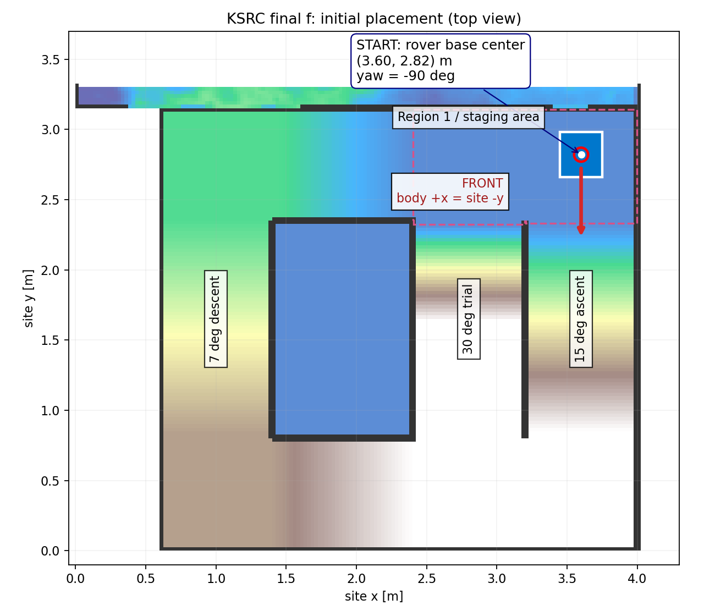

# KSRC 최종 f판 — AP 내부망 운용 CLI

이 폴더는 `YW16 + YW17`의 최종 **f판(ksrc22)** 실행 파일과 필요한 runtime·mission 격자를 함께 담는다. `ORIGIN.json`에 원본·배포 SHA-256이 있다. 기존 `run_policy.py`는 수정하지 않는다. MPPI는 구역 기반이며 depth는 OFF다.

현장에서 사용할 명령어는 **[최상단 CLI.md](../../CLI.md)** 에 모았다. 실제 시험의 순서·기대 동작·합격 기준은 별도 문서 **[현장 시험 절차서](../../FIELD_TESTS.md)** 에 있다.

## 1. 초기 위치와 방향



| 항목 | 기준 |
|---|---|
| 놓는 곳 | 15° 통로의 연장선에 있는 **구역 1 평지** |
| 기준점 | 앞바퀴·카메라가 아닌 **로버 `base_link` 중심** |
| site 좌표 | **x=3.60 m, y=2.82 m** |
| 방향 | **yaw=−90°**, 로버 정면(body +x)이 **site −y**를 향함 |
| 눈으로 보는 방향 | 15° 램프 진입 방향. 그림에서는 아래쪽 |
| 실제 배치 목표 | 위치 약 **5 cm**, 방향 약 **5°** 이내 |
| 시작 조건 | 정상 ORB·IMU, **3초 이상 정지**, 출발 구역·방향 정렬 |

좌표는 `mission/site/site.json`의 site 좌표계다. 카메라/바퀴 끝을 `(3.60, 2.82)`에 맞추지 않는다. 현장에서 로버 중심 위치와 정면 방향을 테이프로 표시해 둔다.

`anchor`는 **사용자가 실제 로버를 위 위치·방향에 맞춘 뒤** 추정 기준을 그 preset으로 지정하는 명령이다. 자동 위치 찾기나 로버 이동 명령이 아니다. 텔레옵으로 정렬하고 3초 정지한 뒤 사용한다. READY 판정의 추정 위치·방향 범위는 8 cm·8°이며 실제 배치 목표 5 cm·5°와 구분한다.

## 2. 현장에 가기 전 준비

이미 Pi에 필요한 Python/ROS/ORB/정책이 설치돼 있다. 현장에서 `pip install`, `apt`, `git pull` 없이 실행한다. 이번 확인 환경은 Pi의 **Python 3.12 / ROS 2 Jazzy**, 노트북 검증 환경은 Python 3.10이다.

Pi 배포 위치:

```bash
/home/pi/ksrc_final_20261022/deployment/ksrc
```

온라인 작업 PC에서 Git checkout의 파일을 Pi에 복사한다. `local/`의 기기 보정·의존성과 `state/`의 로그는 덮어쓰지 않는다.

```bash
cd ~/rover-mapping
ssh raspberrypi 'mkdir -p /home/pi/ksrc_final_20261022/deployment/ksrc'
rsync -a --exclude=__pycache__ --exclude=local --exclude=state \
  deployment/ksrc/ raspberrypi:/home/pi/ksrc_final_20261022/deployment/ksrc/
```

`local/deps`는 이번 배포에서 `/home/pi/ksrc_final_20261022/deps`를 가리킨다(scipy 포함, 인터넷 불필요). 모델 `.pt/.json`은 기존 `/home/pi/ksrc/pi/policy/res8_mlp_v3vo_rc4000`을 사용한다. 기기별 보정·모델·ROS/ORB binary는 Git 코드에 포함되지 않으므로 Pi를 새로 설치하면 사전에 별도 준비해야 한다.

이미 생성한 실기 설정을 다시 만드는 명령:

```bash
cd /home/pi/ksrc_final_20261022/deployment/ksrc
./ksrc configure \
  --orb-settings /home/pi/ksrc/orb/vo1018_16/orb.yaml \
  --urdf /home/pi/ksrc/pi/orb/rover.urdf \
  --imu-json local/imu.json
```

기존 YAML에서는 실측 **640×480 카메라 내부 파라미터와 stereo baseline만** 가져온다. camera·IMU 외부 파라미터는 현재 20° 카메라 URDF에서 다시 만든다. 생성 파일은 `local/real.json`, `local/orb.yaml`이다. 320×240 preview 보정은 640×480 카메라 설정에 대입하지 않으며 CLI가 거부한다. `local/imu.json`은 기존 검증 보정의 복사본이다.

## 3. AP 공유기로 접속

인터넷은 필요 없다. Pi와 노트북을 **같은 AP LAN**에 연결하고, 공유기의 DHCP 예약으로 Pi IP를 고정하는 편이 편하다. 아래 IP는 공유기에서 확인한 실제 Pi 주소를 넣는다.

```bash
# 노트북: 아래 문자열을 실제 AP 내부망 Pi IP로 교체
PI_AP_IP='192.168.0.101'
ping -c 3 "$PI_AP_IP"
ssh -o HostKeyAlias=raspberrypi.local pi@"$PI_AP_IP"

# 이후 Pi SSH 터미널
cd /home/pi/ksrc_final_20261022/deployment/ksrc
./ksrc check
```

`192.168.0.101`은 2026-10-22 home AP에서 확인한 Pi 주소다. 노트북 LAN은 `192.168.0.100`이며 DHCP 재할당 시 달라질 수 있다. `raspberrypi`라는 기존 SSH alias가 다른 네트워크 IP를 가리키면 현장에서는 IP로 직접 접속한다. AP의 client isolation은 꺼져 있어야 기기끼리 SSH할 수 있다. 외부 VPN·hpi-lab 서버는 현장 실행에 필요 없다.

## 4. 모터 없는 연결 시험

```bash
./ksrc start --seconds 120
./ksrc status
# orb_ok=true, stationary_s>=3, in_region1=true 확인
./ksrc start1
./ksrc status
./ksrc estop
./ksrc status
./ksrc stop
./ksrc logs
```

`start`의 **기본은 S1 plan 분리 + FAKE**다. 합성 pose·IMU와 `run_policy --fake`를 사용하며 SPI를 열지 않는다. 정책 파일이 없는 노트북에서도 gateway·실행기 연결은 시험할 수 있다. 합성 입력은 점 로버이므로 램프 물리·슬립·실제 완주 검증이 아니다.

plan 분리 모드 연결 시험:

```bash
./ksrc start --async-plan --upper-cpu 0 --lower-cpu 3 --seconds 120
./ksrc status
./ksrc start2
./ksrc estop
./ksrc stop
```

## 5. 실기 시작·전환·정지

실제 구동 전에 시뮬 검증과 바퀴를 띄운 시험부터 진행할 것을 권고한다. 다음 `--real` 명령은 실제 camera·ORB와 정책의 SPI를 연다. 기존 SPI bridge/텔레옵 직접 제어는 종료하고, 이 세션의 gateway를 사용한다.

```bash
# 선택 S1: plan 분리, ORB 1·2 / 상위 0 / 하위 3, RT 50
./ksrc start --real --async-plan --orb-cpus 1,2 --upper-cpu 0 --lower-cpu 3 --rt 50

./ksrc status

# gateway를 통한 짧은 CLI 텔레옵 예시: 전진 0.03 m/s, 1초 후 0 명령
./ksrc teleop 0.03 0 0 --seconds 1

# 실제 출발 위치·방향으로 맞춘 후 3초 이상 정지
./ksrc anchor
./ksrc status

# 1회차: 30° 짧은 시도 → 후퇴 → 15° 등판 → 정상 관찰 → 7° 하행·복귀
./ksrc start1
./ksrc status

# 소프트웨어 비상 정지: 0 명령 + AUTO 해제, 이후 센서 복구로 AUTO 재개하지 않음
./ksrc estop

# 2회차: 출발점 정렬·정지·anchor 후 실행. 30°·정상 관찰 생략, 하행 0.7배
./ksrc start2

# 전체 종료
./ksrc stop
cat state/stopped.json
```

2026-10-22 사용자 결정으로 **S1 plan 분리**가 기본이다(상위 CPU 0 / 하위 CPU 3 / ORB CPU 1·2 / RT 50). S0 비교만 `start --sync-plan`으로 실행한다. S0/S1은 시드 2·4·7에서 각각 3/3 완주했지만 S1의 위치 추정 오차가 일부 시드에서 더 컸다. 기존 비교는 실제 yaw 0°(+x) 출발이므로 −y 출발 검증과 구분한다. `--rt 50` 적용은 `policy.log`에서 확인한다. `check`의 RT limit도 50 이상이어야 한다.

노트북 GUI는 기존 `teleop/ksrc_snapshot/pi/teleop/teleop_joystick.py`를 `--gateway`로 실행한다. gateway 포트는 **5006**이다. 실제 조이스틱 명령·시작·E-STOP이 동일 gateway로 들어가며, 정책의 5005로 직접 보내는 경로와 혼용하지 않는다.

## 6. 장애·자동 복구

- pose 350 ms 공백, IMU 100 ms 공백, 추적 손실, map 변경: 자동 명령을 0으로 유지한다.
- ORB 프로세스 사망 또는 2초 이상 복구 대기: supervisor가 자신이 띄운 ORB만 재시작한다. 재시도 간격은 최소 8초다.
- 마지막 유효 site pose를 보존하고 새 ORB 원점을 그 pose에 재연결한다. 정지 확인 후 **정상 관측 1초 이상·5개 이상**을 요구하고, 기존 임무 단계로 복귀한다. 복구 중 재공백이 생기면 안정화 확인부터 다시 시작한다.
- E-STOP/STOP으로 AUTO가 해제됐다면 ORB가 복구돼도 AUTO를 자동 재개하지 않는다.
- AUTO 중 노트북·SSH 단절은 자동주행 중단 조건이 아니다. 로컬 supervisor와 gateway가 계속 동작한다. TELEOP 명령만 끊기면 gateway의 300 ms stale 정책으로 0 명령이 된다.
- 실행기·gateway·하위 정책·입력 프로세스가 죽으면 세션 전체를 정지한다. 이 경우 원인을 확인하고 `stop` 후 새 세션을 시작한다.

마지막 pose 연결은 전역 재위치 측정이 아니다. 센서 공백 동안 실제로 미끄러지거나 사람이 로버를 옮기면 그 이동을 정확히 알 수 없다. 특히 복구 중에는 로버를 들거나 이동시키지 않는다. 정지 전 IMU 추정의 오차와 정지 거리는 남을 수 있다.

`estop`은 **UDP 소프트웨어 정지**이며 물리 전원 차단 E-stop과 다르다. 무선 연결이 끊기면 노트북에서 새 정지 패킷을 보낼 수 없으므로 현장 시험에서는 물리 E-stop 담당자를 둔다.

## 7. 상태·로그·회수

```bash
./ksrc view --watch  # Ctrl+C는 보기만 종료
./ksrc report        # CPU·온도·하위 주기 요약
./ksrc logs          # 원시 로그 끝부분이 필요한 경우만
cat state/processes.json
cat state/stopped.json
```

`status`의 주요 필드는 `active`, `recovering`, `stage`, `reason`, `orb_ok`, `stationary_s`, `command`, `pose`, `pose_age_s`, `imu_age_s`다. `stopped.json`이 있으면 표시된 status는 과거 값이다. `navigation.jsonl`에는 명령·pose·단계와 `recovery_start/recovery_done/operator_anchor`가 기록된다. `processes.json`에는 세션 소유 PID·실행 명령이 있다. `pkill -f`로 공유 프로세스를 종료하지 않는다.

로그는 같은 `state/`에 추가된다. 비교 시험마다 아래처럼 다른 기록 폴더를 사용한다. `--state-dir`는 하위 명령보다 앞에 둔다.

```bash
./ksrc --state-dir state/S0_01 start --sync-plan --seconds 120
./ksrc --state-dir state/S0_01 status
./ksrc --state-dir state/S0_01 stop

# 노트북의 다른 터미널에서 AP LAN으로 로그 회수
PI_AP_IP='192.168.0.101'  # 실제 AP 내부망 IP
rsync -a -e 'ssh -o HostKeyAlias=raspberrypi.local' pi@"$PI_AP_IP":/home/pi/ksrc_final_20261022/deployment/ksrc/state/ ./ksrc-field-logs/
```

## 8. 이번에 직접 실행한 확인

2026-10-22 Pi에서 `./ksrc check`, `configure`, ROS import, `start`(FAKE), `status`, `start1`, `estop`, `stop`을 실행했다. 예시 출력은 **[현장 시험 절차서의 확인 기록](../../FIELD_TESTS.md#이번-확인-기록)** 에 있다. 실제 모터 주행·현장 완주를 확인했다는 뜻은 아니다.

## RUN 3·4 추가 — Pi 백업 대조 완료

| 명령/버튼 | 상승 경로 |
|---|---|
| START RUN 1 / `./ksrc start1` | 30° 시도 → 후퇴 → 15° 우회(기존) |
| START RUN 2 / `./ksrc start2` | 15° 직행, 관찰 생략·하행0.7배(기존) |
| START RUN 3 / `./ksrc start3` | 30° 시도 → 후퇴 → 외곽 경로 상승 |
| START RUN 4 / `./ksrc start4` | 처음부터 외곽 경로 상승 |

‘10도 경로’는 외곽 경로의 기존 이름이다. 실제 외곽에는5°·7°·7.27° 구간이 포함된다. 상승 구역 순서는 `1→6→7→8→9→10→4`, 정상 이후에는 기존 관찰·하행·복귀를 재사용한다. RUN3/4의 관찰·하행 속도는 별도 변경 요청이 없어 RUN1 기본값을 유지한다. 30°의5초 전진/10초 경과 중단 정책·후퇴 동작, 시작 정렬/센서/3초 정지 조건, E-STOP은 유지한다.

새 단계는 `outer6→outer7→outer8→outer9→outer10→outer4→summit`. 외곽 상승 중 과도한기울기·정체는 임무 실패·정지로 처리하며30/15도 경사로 잘못 후퇴하지 않는다. 중계도1~4회차를 수신하고 각각의 궤적을 보존한다. 본 주행의 사전 MPPI/슬립 표시 캐시는 노트북의 `deployment/broadcast/data/mission_cache.npz`에 제공하며, 회차·단계·pose/v/w가 맞는 경우에만 표시한다.

모터 없는 검증은 `python deployment/ksrc/validation/run_variants_kinematic.py`. 실제 MPPI+점기구학으로 RUN3/4의 정상·복귀 완료를 확인했으나, 센서 오차·바퀴 접촉·모래·실기 완주 검증은 아니다. 실기 적용 전 시뮬레이션과 바퀴를 띄운 시험을 권장한다. 2026-10-23 Pi 백업 `cmwcmw57/pi-backup@7e2f955`와 대조했다. 기존 배포 HEAD와 65개 파일이 동일했고, 차이는 gateway의 상태 응답 소스 포트 수정과 ORIGIN 기록이었다. 저수준 정책은 `/home/pi/ksrc/pi/policy/run_policy.py`, 모델은 같은 폴더의 `res8_mlp_v3vo_rc4000`을 계속 사용한다. `SpiLink.exchange/exchange_res`, 보정 축, UDP 명령 형식은 연결 가능한 구조로 확인했다. 백업을 실제 Pi에서 실행한 검증은 아니다. 업데이트·리허설 순서는 [CLI.md](../../CLI.md)를 따른다.
